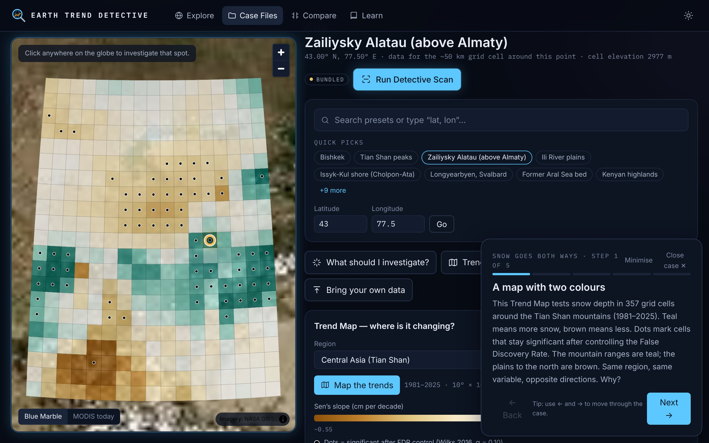
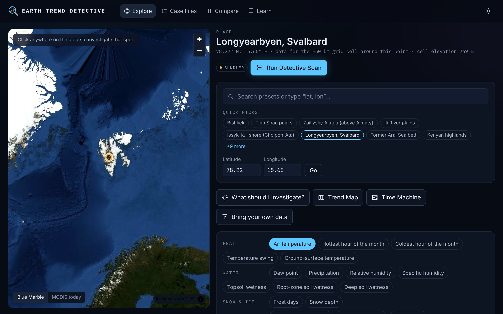
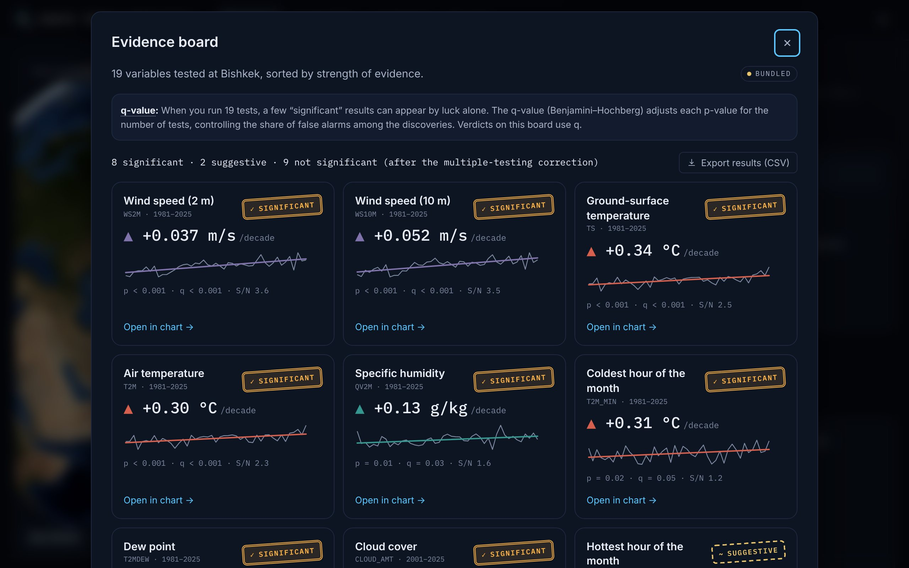
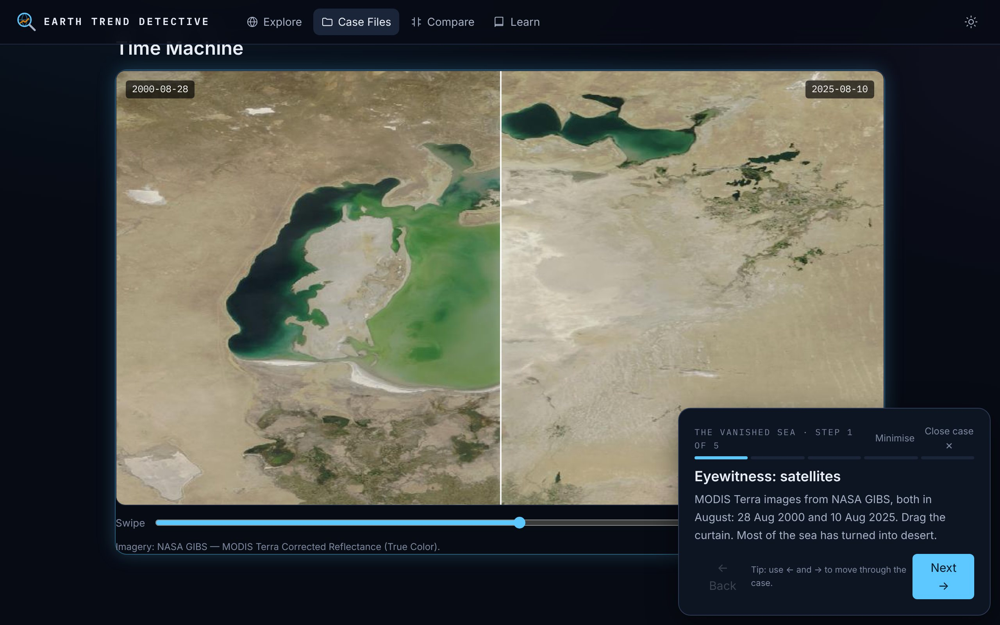
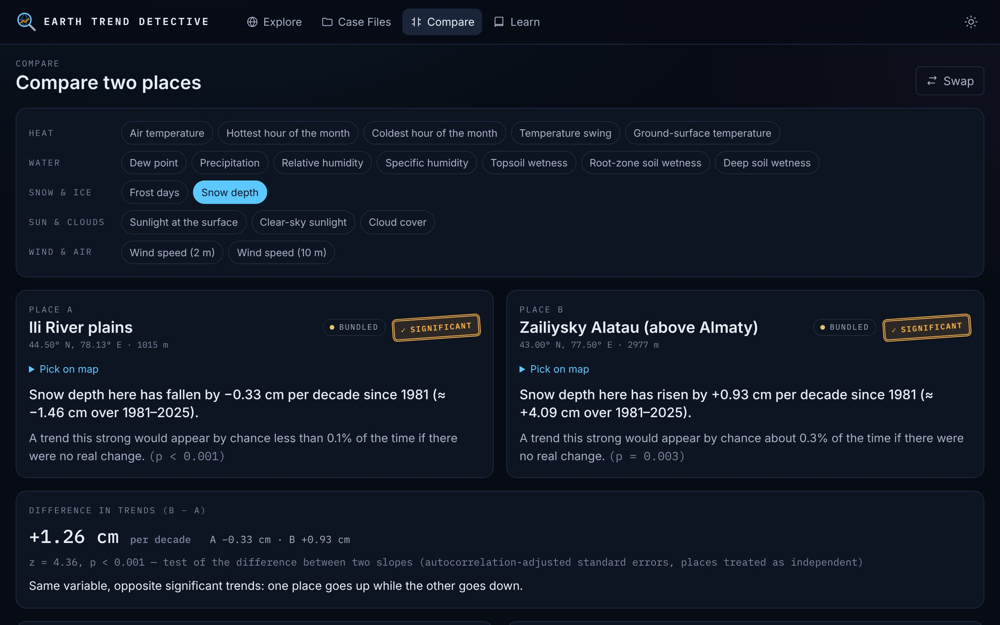
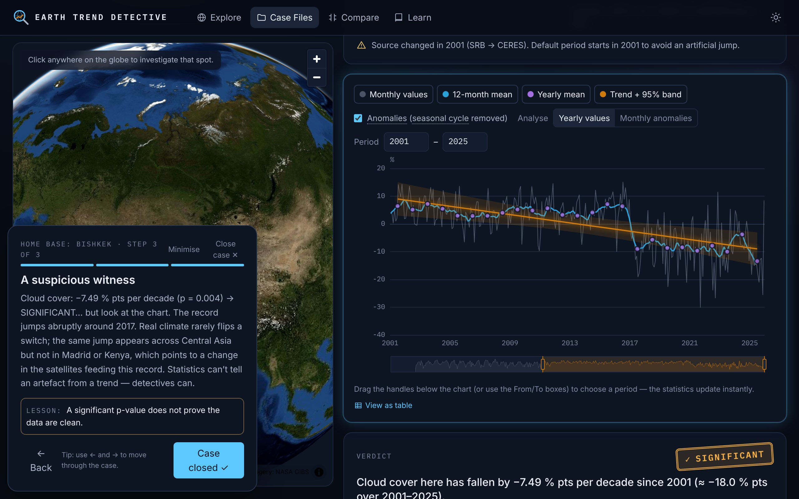

# Earth Trend Detective

**Is it really changing? Investigate 45 years of NASA Earth data — right in your browser.**

🔎 **Live demo: https://seytekm.github.io/Nasa_crack/**

Pick a place and a variable (temperature, rain, snow, sunlight, wind…), and the
detective tells you **what is changing, where, by how much, and whether it is
statistically significant** — in plain language, with the statistics one click
away. Built for the NASA Space Apps Challenge for high-school and university
students and anyone with basic science background.



| | |
|---|---|
|  |  |
|  |  |
|  |  |

## What it does

| Mode | What you get |
|---|---|
| **Explore** | Globe (NASA GIBS imagery) → click any point. 19 variables from NASA POWER, monthly 1981 → last complete year. Chart with monthly values, 12-month mean, yearly means, trend line and 95 % band; drag the slider to change the period and the statistics update instantly. Verdict stamp: **SIGNIFICANT / SUGGESTIVE / NOT SIGNIFICANT (YET)** with a correctly worded sentence. |
| **What should I investigate?** | 3-question wizard. Classifies the place from its own climatology (desert, polar, mountain, tropics…) and suggests 3–5 variables with reasons. Rules are plain data in `src/content/rules.ts`. |
| **Detective Scan** | One request, 19 trend tests in a Web Worker, an *evidence board* sorted by strength of evidence, with Benjamini–Hochberg q-values and warnings for suspicious jumps. |
| **Trend Map** | Sen's slope + Mann-Kendall test for every grid cell of a ≤ 10° × 10° region, False Discovery Rate control (Wilks 2016) with stippling. Shows *where* a variable goes up and where it goes down. |
| **Case Files** | Five guided investigations with real data (all numbers computed live): *Snow goes both ways* (Tian Shan), *Arctic fever* (Svalbard), *The vanished sea* (Aral), *Home base: Bishkek* (a data artefact), *Almost significant* (Issyk-Kul). |
| **Time Machine** | Before/after curtain between two MODIS Terra images (GIBS), e.g. the Aral Sea in Aug 2000 vs Aug 2025. |
| **Compare** | Two places, one variable, shared axes, test of the difference between slopes. |
| **Site check** | Draw an area on the globe, choose a building type (hospital, school, housing, warehouse, solar plant) and get a **0–100 suitability score**. Ground from NASA GIBS maps decoded pixel by pixel (water share, slopes and altitude from ASTER elevation, landslide hazard) — seas, lakes, steep mountains and very high ground are marked *not buildable*; climate from 30 years of NASA POWER (heat, cold, heavy rain, water, snow, wind, sunshine, trends). A screening only: earthquakes, river flood zones, soils, roads and population are not included, and the panel says so. |
| **Bring your own data** | Drop a CSV (e.g. a NASA Giovanni area-averaged export of MODIS, OMI, AIRS, GPM IMERG, GLDAS) — same analysis, nothing leaves the browser. |
| **Learn** | How it works, glossary, formulas, assumptions & limitations, references, Giovanni how-to. |

Every scientific term in the UI has a glossary tooltip. Export: CSV (series and
statistics, with attribution), PNG chart, and a share link (the whole view
state lives in the URL).

## Quick start

```bash
npm install
npm run dev          # http://localhost:5173
```

```bash
npm run lint         # ESLint + TypeScript (strict)
npm test             # 140 Vitest tests (stats vs SciPy/pymannkendall, data layer, case-file claims)
npm run build        # static site in dist/
npm run smoke        # Playwright smoke test of dist/, online and fully offline
```

Optional maintenance scripts:

```bash
NODE_USE_ENV_PROXY=1 npm run prefetch      # re-download bundled data (points, regions, images, tiles)
python3 scripts/make_fixtures.py           # regenerate stats fixtures (pip install scipy pymannkendall numpy)
```

### Deploy

* **GitHub Pages**: push to `main`; `.github/workflows/deploy.yml` lints, tests,
  builds with `BASE_PATH=/<repo>/` and publishes `dist/` (enable *Pages → Source:
  GitHub Actions* in the repo settings).
* **Any static host** (Netlify, Vercel…): `npm run build`, publish `dist/`
  (`BASE_PATH` defaults to `/`).
* No backend, no API keys. NASA POWER and GIBS send CORS headers, so the browser
  calls them directly. An optional Cloudflare Worker proxy lives in `proxy/`
  (`VITE_POWER_PROXY=https://…`) but is not needed.

### Works offline

Everything used by the Case Files — 17 places, 8 regional grids, 2 satellite
images and low-zoom globe tiles (~13 MB) — is bundled in `public/data/demo/`.
Each dataset is labelled **LIVE**, **CACHED** (IndexedDB) or **BUNDLED**.
`npm run smoke` verifies the whole demo with every external host blocked.

## Data

| Source | Used for | Notes |
|---|---|---|
| **NASA POWER** Monthly & Annual API v2.10.0 (`power.larc.nasa.gov`), community AG | All time series (point: 19 variables in one request; regional: 1 variable, 2°–10° boxes) | Meteorology from the **MERRA-2 reanalysis** (0.5° × 0.625°, from 1981); solar & cloud from **GEWEX SRB** (1984–2000) → **CERES SYN1deg** (2001→), 1° grid. Fill value −999; POWER's 13th "annual" month is dropped and yearly values are recomputed. |
| **NASA GIBS** (WMTS EPSG:3857 & WMS) | Globe base map (Blue Marble, MODIS Terra true colour, labels), Time Machine snapshots | Layer names and TileMatrixSets checked in GetCapabilities. |
| **NASA Giovanni** exports (user-supplied) | Bring your own data | MODIS, OMI, AIRS, GPM IMERG, GLDAS, … |

All endpoints, limits and formats were verified with real requests — see
[`docs/DATA_NOTES.md`](docs/DATA_NOTES.md). Two artefacts found in the data are
handled explicitly: a step in solar/cloud variables in **2001** (source change,
so those variables default to 2001 →) and an abrupt **2017** drop in cloud cover
over Central Asia (flagged by the step-change check).

**Attribution.** *The data was obtained from National Aeronautics and Space
Administration (NASA) Langley Research Center's Prediction Of Worldwide Energy
Resources (POWER) project funded through the NASA Earth Science Division* —
POWER Monthly and Annual API v2.10.0. *We acknowledge the use of imagery
provided by services from NASA's Global Imagery Browse Services (GIBS), part of
NASA's Earth Science Data and Information System (ESDIS).* The NASA logo is not
used; this is not an official NASA product.

## Methods (short version)

* **Preprocessing** — fill values removed; monthly anomalies (value − same-month
  mean); yearly values: day-weighted mean, or Σ mm/day × days for precipitation,
  or sum for frost days; incomplete years skipped.
* **Primary test** — OLS trend on yearly values with an **AR(1) autocorrelation
  correction** (Santer et al. 2000: n_eff = n(1 − r₁)/(1 + r₁)); slope per decade,
  95 % CI, total change over the period.
* **Robust checks** — Mann-Kendall (tie-corrected, continuity correction),
  Kendall's τ, Sen's slope with Gilbert's CI, Hamed–Rao modified MK, Seasonal
  Mann-Kendall on monthly data.
* **Many tests** — Benjamini–Hochberg q-values (Scan), Wilks (2016) FDR with
  α_FDR = 0.10 (Trend Map).
* **Years to significance** — smallest record length at which the same slope,
  noise and r₁ would pass the test (always shown as a thought experiment).
* **Step-change check** — BIC of "one jump" vs "straight line"; warns when a
  "trend" looks like a data-source change.
* **Verdicts** — p < 0.05 SIGNIFICANT, 0.05–0.10 SUGGESTIVE, otherwise NOT
  SIGNIFICANT (YET). We never say "there is no trend".

All statistics are hand-written TypeScript in `src/stats/` (no UI dependencies)
and tested against **SciPy** and **pymannkendall** to 1e-6 on synthetic series
(trend, no trend, ties, gaps, autocorrelation, short) and on a real POWER
series. Full formulas, assumptions and references are in the app's *Learn* page.

## Project structure

```
src/
  stats/        pure TS statistics + tests (fixtures from scripts/make_fixtures.py)
  data/         POWER client, queue/backoff, IndexedDB cache, loader, catalog, GIBS, CSV parser
  workers/      Comlink worker: Detective Scan + Trend Map
  features/     explore, analysis, scan, trend-map, case-files, compare, time-machine, upload, learn, wizard, map
  components/   shared UI (stamp, glossary term, modal, sparkline…)
  content/      i18n dictionary (en), tours, rules, places
  state/        Zustand store + URL-hash sync
public/data/    bundled offline data (manifest + demo/)
scripts/        prefetch.ts, make_fixtures.py, smoke.cjs
docs/           SPEC, DATA_NOTES, DECISIONS, DESIGN, screenshots
```

Stack: Vite, React 19, TypeScript (strict), Tailwind CSS 4, MapLibre GL JS
(globe projection), Apache ECharts, Zustand, Comlink, idb-keyval, Vitest,
Playwright. All UI strings live in one dictionary (`src/content/i18n/en.ts`) —
add a language by copying it.

## Limitations

* Reanalysis values are model estimates for ~50 km grid cells, not station
  measurements; mountains, coasts and lakes are especially uncertain.
* A straight line summarises change; it does not claim the change is linear.
  The AR(1) correction does not capture longer-memory variability.
* Significance ≠ importance; "not significant" ≠ "no change".

## Documentation

[`docs/SPEC.md`](docs/SPEC.md) (brief) · [`docs/DATA_NOTES.md`](docs/DATA_NOTES.md)
(verified API facts) · [`docs/DECISIONS.md`](docs/DECISIONS.md) (every
autonomous decision) · [`docs/DESIGN.md`](docs/DESIGN.md) (visual direction) ·
[`SUBMISSION.md`](SUBMISSION.md) (Space Apps write-up, video script, slides).
